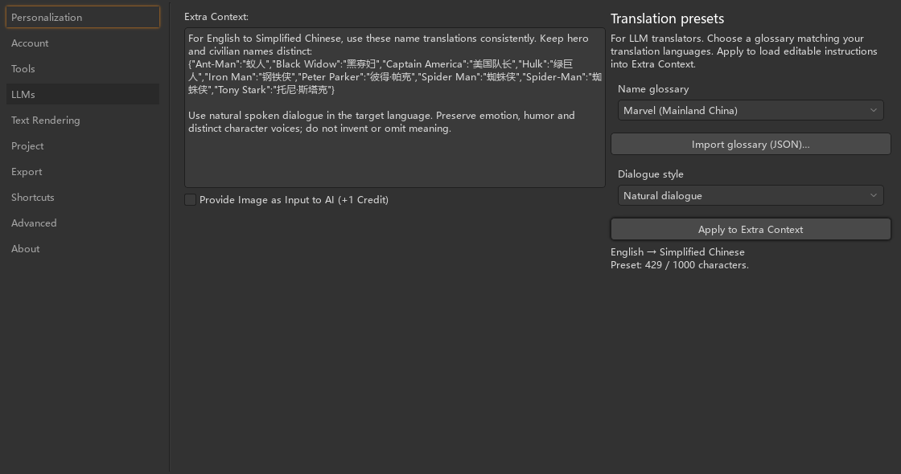

# Translation presets

Use **Settings → LLMs → Name glossary / Dialogue style → Apply to Extra Context** before translating a comic. Choose a glossary whose source and target languages match the translation settings; applying a preset does not change those languages.



The built-in Marvel glossaries are small regional starting points, not a complete or universally authoritative comic dictionary. They include six hero names, two civilian names and the `Spider Man` spelling variant. Hero and civilian names remain separate: `Iron Man` is not replaced with `Tony Stark`. Adaptations, publishers and editions can use different names. Edit the generated context or import a glossary for your edition.

## Applying and saving

- **No style instructions** adds no tone rules; **Faithful to original** preserves tone and register; **Natural dialogue** asks for fluent spoken dialogue without inventing meaning or flattening character voices. Styles can also be applied without a glossary.
- Selecting options does not change Extra Context. **Apply** replaces non-empty, different context only after confirmation. The result is ordinary editable context, so add story details or change individual names there.
- Imported glossaries are saved in application settings and remain available after restarting. Applied instructions are stored in existing project files, so reopening a project does not require its original glossary file.
- Presets use the existing context limit: 1000 characters for non-Custom translators, unlimited for Custom. Oversized presets are rejected before changing the editor. Use a smaller glossary or Custom for larger dictionaries.
- LLM requests receive the instructions through the existing Extra Context field. The output format, API protocol and project format are unchanged. Traditional translators do not use these instructions. Glossary or style changes alter the existing translation cache key when applied.

These are model instructions, not a deterministic replacement pass. Check the output: a model can still disregard a term or tone instruction, and OCR mistakes can obscure names.

## Importing your own glossary

Save the following as a UTF-8 `.json` file and click **Import glossary (JSON)…**. UTF-8 BOM is also accepted. The imported glossary is selected, but does not replace context until you click **Apply**.

```json
{
  "name": "My Marvel edition",
  "source_language": "English",
  "target_language": "Simplified Chinese",
  "terms": {
    "Spider-Man": "蜘蛛侠",
    "Peter Parker": "彼得·帕克",
    "Iron Man": "钢铁侠",
    "Tony Stark": "托尼·斯塔克"
  }
}
```

All four fields are required. The first three must be non-empty strings. `terms` must be a non-empty object of non-empty source names and translations. Duplicate JSON keys, including duplicate source names, are rejected; names that collide after trimming whitespace are also rejected. Use separate entries for aliases and spelling variants. The same format works with other language pairs and comic series.

Reimporting a custom glossary with the same name asks before replacing it. Built-in glossary names are reserved; use a different name for a customized version. Invalid or unreadable imports leave the existing selection, saved glossaries and Extra Context unchanged.

## Built-in name references

The following starter names were checked against regional publisher, Disney and licensed-product pages on 2026-10-07. References establish the spellings used by these presets, not a single spelling for every comic continuity or edition. Only names are included, not source descriptions or artwork.

| Source name | Mainland China | Taiwan | Hong Kong |
| --- | --- | --- | --- |
| Spider-Man / Spider Man | 蜘蛛侠 | 蜘蛛人 | 蜘蛛俠 |
| Peter Parker | 彼得·帕克 | 彼得帕克 | 彼得柏加 |
| Iron Man | 钢铁侠 | 鋼鐵人 | 鐵甲奇俠 |
| Tony Stark | 托尼·斯塔克 | 東尼史塔克 | 東尼史達 |
| Captain America | 美国队长 | 美國隊長 | 美國隊長 |
| Hulk | 绿巨人 | 浩克 | 變形俠醫 |
| Black Widow | 黑寡妇 | 黑寡婦 | 黑寡婦 |
| Ant-Man | 蚁人 | 蟻人 | 蟻俠 |

**Mainland China**

- [LEGO China: Captain America: Civil War](https://www.lego.com/zh-cn/product/captain-america-civil-war-action-battle-76314) lists Spider-Man, Iron Man, Captain America, Black Widow and Ant-Man in Simplified Chinese; [Avengers Tower](https://www.lego.com/zh-cn/product/avengers-tower-76269) also lists Hulk.
- [Sony China: Spider-Man](https://www.sony.com.cn/content/sonyportal/zh-cn/cms/newscenter/corporate/2026/20260727-1.html) supplies Peter Parker's spelling.
- [Hong Kong Disneyland's Simplified Chinese press release, hosted by the Hong Kong Tourism Board](https://partnernet.hktb.com/filemanager/communication/enewsletter/2148/file/sc/170111_HKDL_IMX_Grand_Opening_Press_Release_SC.pdf) explicitly distinguishes Tony Stark's Simplified Chinese spelling from the Hong Kong variant.

**Taiwan**

- [Disney Taiwan: Marvel Studios](https://www.disney.com.tw/marvel-studio-brand) supplies Iron Man, Tony Stark, Captain America, Hulk and Ant-Man.
- [Disney+ Taiwan: Your Friendly Neighborhood Spider-Man](https://www.disneyplus.com/zh-tw/browse/entity-b1417e49-48ad-4827-bfd6-94580ecbecd7) supplies Spider-Man and Peter Parker; [Black Widow](https://www.disneyplus.com/zh-tw/browse/entity-d9cd6bd1-bcf8-4a3b-8f92-0fdd4f79ac08) supplies Black Widow.

**Hong Kong**

- [Hong Kong Disneyland: Marvel seasonal event](https://news.hongkongdisneyland.com/zh-hk/press/2023-04-28/) lists Iron Man, Spider-Man, Captain America, Black Widow and Ant-Man.
- [Disney+ Hong Kong: Avengers](https://www.disneyplus.com/zh-hk/browse/entity-d2ab699b-67da-4906-a7a4-5bc542c953cf) supplies Hulk; [Iron Man](https://www.disneyplus.com/zh-hk/browse/entity-0c520152-b81f-4c20-9310-003debd1947e) supplies Tony Stark; [Your Friendly Neighborhood Spider-Man](https://www.disneyplus.com/zh-hk/browse/entity-b1417e49-48ad-4827-bfd6-94580ecbecd7) supplies Peter Parker.

## Verification

With the project's dependencies installed, run:

```bash
python -m unittest discover -s tests -v
```

The checks use real Qt controls with temporary settings, actual project save/load, and mocked translation requests. They cover import failures, replacement cancellation, length boundaries, persistence, region/style changes and translation entry points. They do not call paid translation services or measure live model quality. The screenshots show real settings controls rendered offscreen.
